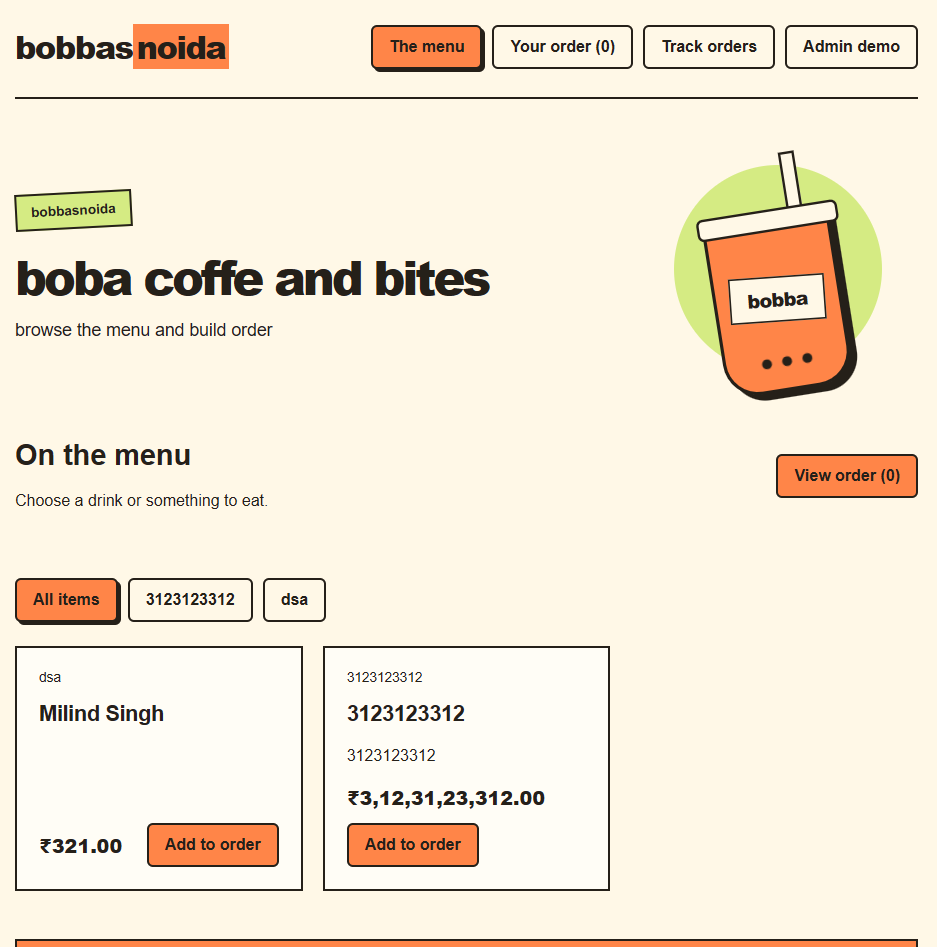

# bobbasnoida 🧋

a cafe ordering demo where u can try both sides of the counter. add drinks and food from admin, put together an order, and follow it until it's ready.

## why i made this

made this for Hack Club YSWS. wanted to build a cafe app with a menu that can be changed from a dashboard instead of keeping all the items fixed in code.

## how to try it

1. open **Admin demo** and add your first menu item. set a name, category and price. sizes are optional.
2. go to **The menu**, pick some items and add them to your order.
3. open **Your order** to change quantities or remove stuff.
4. checkout with a name and choose takeaway or dine-in. dine-in needs a table number.
5. the receipt shows up in **Track orders**.
6. go to **Admin demo → Orders** to move it through Placed, Preparing, Ready and Completed.

the menu starts empty so u can make your own. refreshing keeps your saved items and orders. **Reset demo** in admin clears them if u want to start over.

## images


## running it locally

built with React, TypeScript and Vite. install Node.js 22.12 or newer, then open a terminal in the project folder:

```powershell
npm ci
npm run dev
```

open the local link printed in the terminal.

## building it

```powershell
npm run build
npm run preview
```

the build goes into `dist`, which can be uploaded to a static host.

## a few things to know

this is a demo. there are no real payments or accounts, and admin is open so anyone can try it. everything saves in your browser, so another device or browser profile won't have the same menu and orders.

## AI usage declaration

i used AI to help plan the project, write parts of the code, implement checkout and order tracking, fix bugs, and test the app.

[MIT license](LICENSE)
